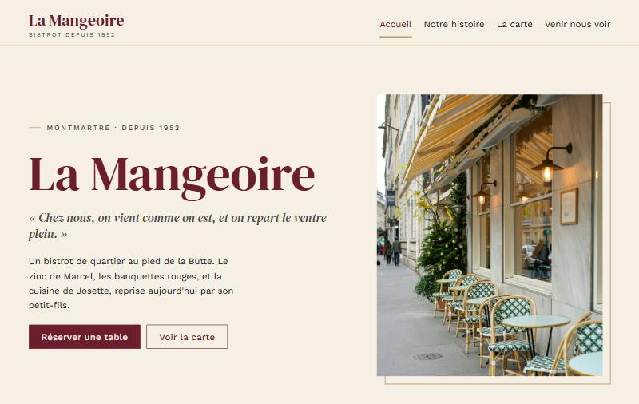
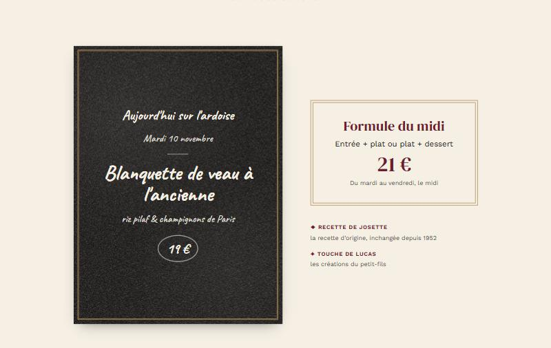
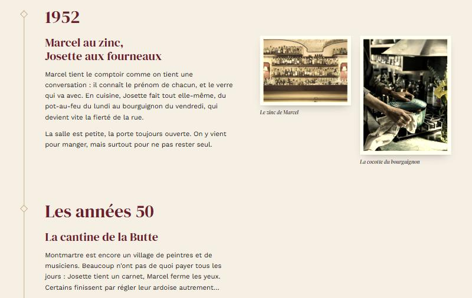
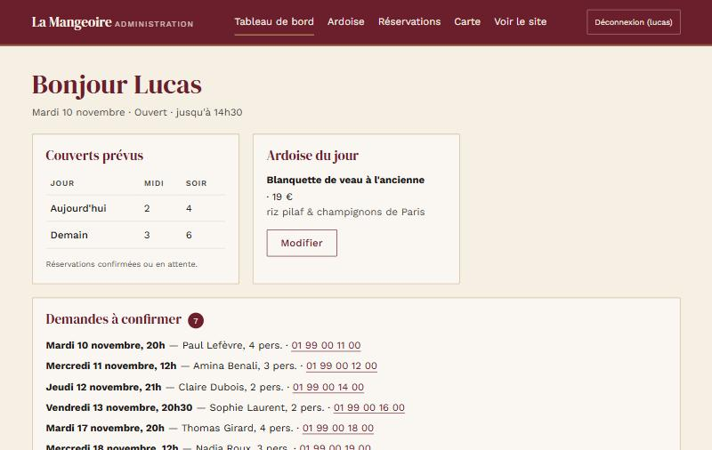
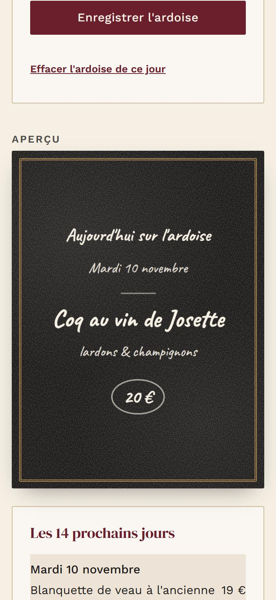

# La Mangeoire

**Site vitrine d'un bistrot parisien fictif, avec réservation en ligne et tableau de bord.**
PHP 8 et MySQL, sans framework · Projet de portfolio de Ricardo Remond

**[Voir le site en ligne →](https://la-mangeoire-demo.alwaysdata.net)**

> « Chez nous, on vient comme on est, et on repart le ventre plein. »
> Bistrot de Montmartre tenu par la même famille depuis 1952 : Marcel et Josette, puis Bernard,
> et aujourd'hui Lucas, le petit-fils. Les personnes, l'adresse et le téléphone sont inventés.



| La carte, lue en base | Notre histoire |
|---|---|
|  |  |

| Tableau de bord (privé) | L'ardoise sur téléphone, aperçu en direct |
|---|---|
|  |  |

---

## Ce que fait le site

- **Une identité soignée** : rétro mais épurée, palette de quatre couleurs en variables CSS,
  trois éléments graphiques seulement (ardoise, photos sépia, filets dorés).
  L'ardoise et sa texture de craie sont en CSS pur, sans image.
- **La carte et l'ardoise du jour viennent de MySQL**, avec un mode démo : un jour sans ardoise,
  le site en reprend une déjà écrite, pour ne jamais rester vide.
- **La réservation en ligne** : créneaux calculés à partir des horaires, jours de fermeture,
  délai d'une heure, limite à deux mois, messages d'erreur accessibles.
- **Le badge « Ouvert maintenant »** (« Fermé · ouvre mardi à 12h »), calculé à partir des horaires.
- **Un tableau de bord pensé pour le téléphone** : écrire l'ardoise avec un aperçu à la craie,
  confirmer ou annuler les réservations, gérer la carte et la formule.
- Un plan d'accès dessiné en SVG, l'agrandissement des toiles avec `<dialog>`,
  une version imprimable de la carte, et des animations coupées si l'utilisateur le demande.

## Choix techniques

- **PHP 8 et MySQL sans framework**, pour montrer les bases : includes réutilisables, PDO avec
  de vraies requêtes préparées, tout le SQL du site regroupé dans un seul fichier par usage.
- **HTML sémantique, CSS et JavaScript natifs**, mobile en priorité. Le site fonctionne
  sans JavaScript : le script ne fait qu'ajouter du confort (menu, aperçus, animations).
- **Le site public ne dépose aucun cookie** : pas de bandeau de consentement, polices
  hébergées localement (aucun appel à Google Fonts).
- **Pas de dépendance** : ni Composer, ni npm, ni outil d'assemblage.

## Sécurité

- **Requêtes préparées** partout et **échappement** systématique à l'affichage (`e()`).
- **Réservation sans cookie** : contre les robots, un champ piège invisible et un jeton signé
  (HMAC) qui contient l'heure d'affichage, plus une limite de demandes par heure.
- **Tableau de bord** :
  - mots de passe hachés (`password_hash`), comptes créés en ligne de commande, sans page d'inscription ;
  - cookie de session limité à `/admin/`, `HttpOnly`, `SameSite=Strict`, `Secure` en ligne ;
  - identifiant de session renouvelé à la connexion, déconnexion après 2 h d'inactivité ;
  - jeton CSRF sur chaque action, connexion et déconnexion comprises ;
  - blocage de 15 minutes après 5 échecs, comptés par MySQL pour que des essais simultanés
    ne passent pas au travers.
- **En ligne** : HTTPS forcé, en-têtes de sécurité, dossiers internes inaccessibles,
  erreurs PHP jamais affichées aux visiteurs, secrets uniquement sur le serveur (jamais dans Git).
- **RGPD** : seules les données utiles sont collectées, sans adresse IP ; les réservations
  sont supprimées automatiquement trois mois après le repas.

## Qualité vérifiée

| Contrôle | Résultat |
|---|---|
| Lighthouse mobile (accueil, histoire, venir nous voir) | performance 91 à 100 ; accessibilité, bonnes pratiques et SEO à 100 |
| Validateur W3C | aucune erreur |
| Test des résultats enrichis Google | fiche « Restaurant » valide (données structurées JSON-LD) |
| `tests/securite.php` | 25 vérifications : connexion et blocage, réservation, prix, horaires |

## Démarche

Le projet a avancé en huit phases, chacune validée avant de passer à la suivante :
fondations, composants, pages statiques, base de données, réservation, finitions,
tableau de bord, puis mise en ligne. L'historique Git suit ces étapes.

---

## Installer le projet en local

**Prérequis** : [Laragon](https://laragon.org/) (Apache, PHP 8.1+, MySQL), ou tout serveur
Apache avec PHP 8.1+ (extensions `intl`, `mbstring`, `pdo_mysql`) et MySQL ou MariaDB.

1. Placer le projet dans `C:\laragon\www\la-mangeoire`, puis cliquer sur **Recharger** dans Laragon :
   le site est servi sur `http://la-mangeoire.test`.
2. Base de données, en `root` :
   - mettre un mot de passe à la place de `CHANGER_CE_MOT_DE_PASSE` dans `sql/creation-base.sql`,
     puis exécuter ce fichier (base et utilisateur dédié) ;
   - exécuter `sql/schema.sql` puis `sql/seed.sql` (données de démonstration).
3. Copier `config/config.example.php` en `config/config.local.php` et y mettre l'adresse du site,
   le même mot de passe et une clé secrète aléatoire (`php -r "echo bin2hex(random_bytes(32));"`).
   Ce fichier est exclu de Git.
4. Créer un compte pour le tableau de bord (`/admin/`) : `php outils/creer-admin.php lucas`
   (`--supprimer lucas` pour le supprimer).

**Attention** : `sql/schema.sql` supprime toutes les tables, comptes compris, et `sql/seed.sql`
remplace la carte, les ardoises et les réservations. Ne jamais les lancer sur le site en ligne.

**Tests**, MySQL démarré : `php tests/securite.php`

**Images techniques** (image de partage, `favicon.ico`, `apple-touch-icon.png`) :
`php outils/generer-images.php`

## Structure

```
la-mangeoire/
├── *.php          pages publiques
├── admin/         tableau de bord
├── includes/      morceaux de page, connexion, requêtes, réservation, sécurité de l'admin
├── config/        configuration (site.php versionné ; config.local.php exclu de Git)
├── sql/           création de la base, tables, données de démonstration
├── outils/        scripts en ligne de commande (comptes, images)
├── tests/         tests en ligne de commande
├── docs/captures/ captures d'écran de ce README
└── assets/        CSS, JavaScript, polices (.woff2 et licences), images
```

## Mise en ligne (alwaysdata)

Le code est envoyé par Git en SSH dans un dépôt nu (`~/depot.git`), puis déposé dans `~/www`.
`config/config.local.php` n'existe que sur le serveur. Pour publier une mise à jour :

```
git push ssh://la-mangeoire-demo@ssh-la-mangeoire-demo.alwaysdata.net/home/la-mangeoire-demo/depot.git main
ssh la-mangeoire-demo@ssh-la-mangeoire-demo.alwaysdata.net "git --git-dir=depot.git --work-tree=www checkout -f main"
```

## Crédits

- Polices sous licence SIL Open Font License 1.1 (textes dans `assets/fonts/licences/`) :
  DM Serif Display, Work Sans, Caveat.
- Photographies sous [licence Unsplash](https://unsplash.com/license) : Megan Bucknall,
  Oliver Frsh, Odiseo Castrejon, Lefteris Kallergis, Alfonso Betancourt
  (liens dans les mentions légales du site).
